# Individual Skills Lab: Documentation of Learning Process

## Contents
- [Intro](#intro)
- [Reaper](#reaper)
- [Mixing Techniques](#mixing-techniques)
- [Audio Technology](#audio-technology)

## Intro

Starting my first year in Sound Design just a couple weeks ago, the gaps in my knowledge became quickly apparent. During the course of this Individual Skills Lab, I aim to start filling in those gaps accross three skill areas: working with **Reaper**, transitioning into **Mixing Techniques**, and finally learning the basics of recording in **Audio Technology**. I chose these three areas, as they contain the most fundemantal missing skills: regaining basic familiarity with using a DAW, gaining basic audio production skills, as well as broadening my vocabulary within the audio field. We discussed that the reason I decided to not focus on Plugdata at the time being, is because I have had experience with visual programming before and am therefore more confident to learn as I go within this area. Music, Sound Design and Synthesizers, are more specialized topics that are easier to build on after going through this learning process.

## Reaper

### Motivation

Knowing how to work efficiently with Reaper as Digital Audio Workstation is an essential skill across many courses. My past experiences with DAW's have been quite limited - I used to play around in Audacity as a teenager, and later did some experiments in Ableton. In software engineering, knowing how to properly use your IDE allows you to put your focus on the creative aspects of crafting an application. Similarly, I hope to gain a basic understanding of Reaper as a DAW, so that while I acquire mixing skills, I can spend less time trying to find the right features in Reaper, and more time testing out different techniques.

### Learning process

##### Step 1: Watch the first part of Reaper's video tutorial series, take notes, and start getting familiar with the software.

Before starting the tutorial videos, I decided to watch the [Benefits of reaper over other DAWS](https://www.reaper.fm/videos.php#PJrN23efnbw), to get a bit of context about Reaper before diving in. I also downloaded the user guide and skimmed through its table of content for further reference.

Next, I installed Reaper for my Linux distribution. The installation process was very straightforward, I didn't run into any issues at first and started the video tutorial series while following along with the software.

I went through the first 5 videos and took notes of all the tips mentioned, while trying out the different concepts demonstrated. It was definitely a lot of information at once, but the videos were well structured.

I followed along the videos to set up a project and test the guitar input, as well as the mic input with voice and violin. 

The interface I had was plug and play, I didn't need to install any drivers for it to work. 

I adjusted the volume of the different tracks using the mixers after recording, I here realized I didn't have the sliders on my interface set up correctly, so after these tests I continued with the rest of the videos before recording again. I made some cuts using the razor tool to made a first mix, but when I tried to loop one of the cut tracks by dragging it, it didn't work how i thought (extends original audio file, not the cut one), so i had to manually duplicate it with `CTRL` + drag. I must check this out before ending this topic.

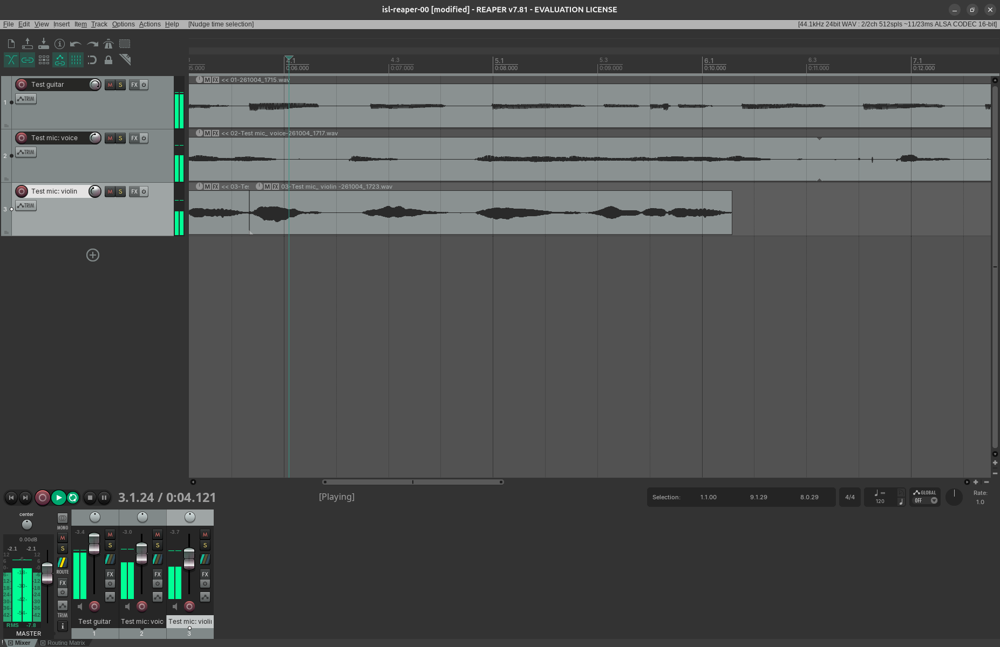
*Reaper test project with first recordings of mic line and guitar line*

##### Step 2: Create recordings in Reaper, while continuing videoseries

It was quite hard to figure out how to start creating the artefact, as I never mixed music before, and have mainly worked with visual media only. At the start I thought about creating a sonification of game footage to give me a more defined space to work with. I decided against this, because I thought it would overcomplicate the current exercise, and it might be harder to demonstrate the learned concepts from the tutorial. 

Instead, I started with creating a simple bass loop on my guitar and work around this. This loop reminded me of a scene of somebody sitting down, opening a can and relaxing. So I thought about recording some sounds that captured that vibe and adding them to the music piece, a can opening, slurping sound, a sigh. I added some more strings to get a first interesting piece.

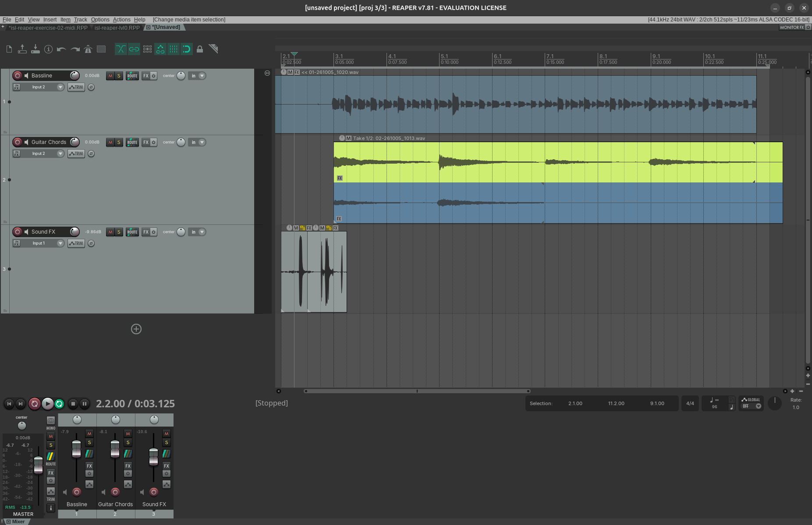
*First version of the song in Reaper*

From here, I decided to continue with the videoseries, to get some more knowledge in how to add interesting elements.

During the 6th video, Recording Midi, I encountered a first issue with the Linux setup, when trying to install the `Iota mini` VSP. Since many VSP's are only built for Windows, I had to set up `wine` and `yabridge` to always be able to use VSP's built for Windows. It took me some time to resolve the issues the version conflicts created, but I was eventually able to get it running going through `yabridge`'s readme guides in detail. I am glad I read up into the docs and resolved this issue now, to avoid any further problems with my Linux setup.

Once the `Iota mini` plugin was properly setup, I followed through the video and had some fun testing out my MIDI keyboard. The workflow with Recording and timing the midi keys was a bit frustrating at first, but I found the MIDI Editor extremely helpful in refining the recorded notes. After continuing watching more tutorial videos, I then added a simple drumline to my project, and started playing around with effects.

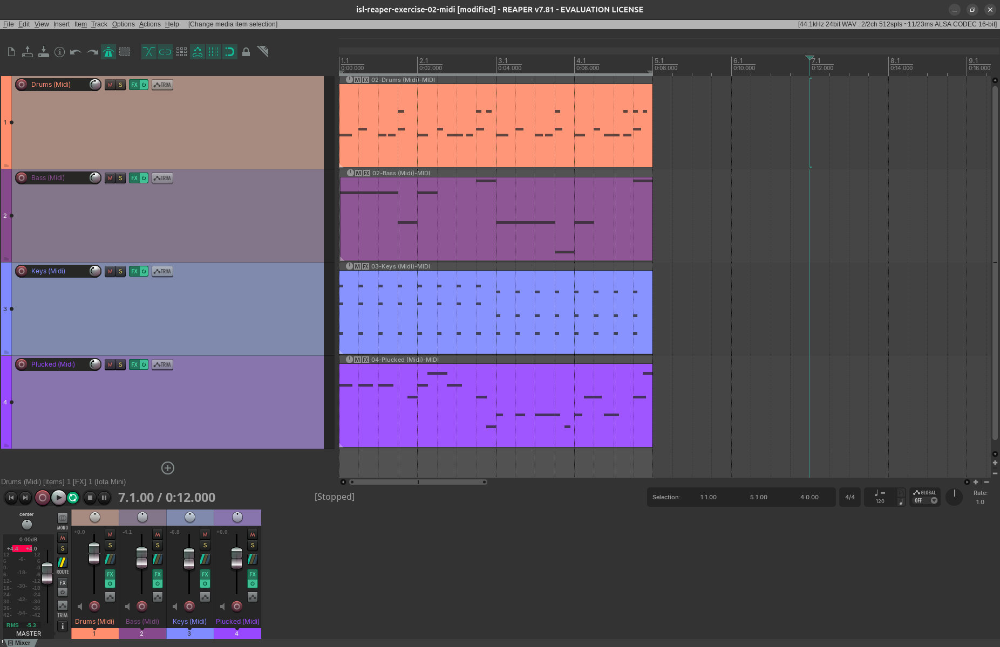
*Reaper test project with multiple MIDI tracks*

Continued on prototype by adding MIDI drum track, and started playing around with FX.

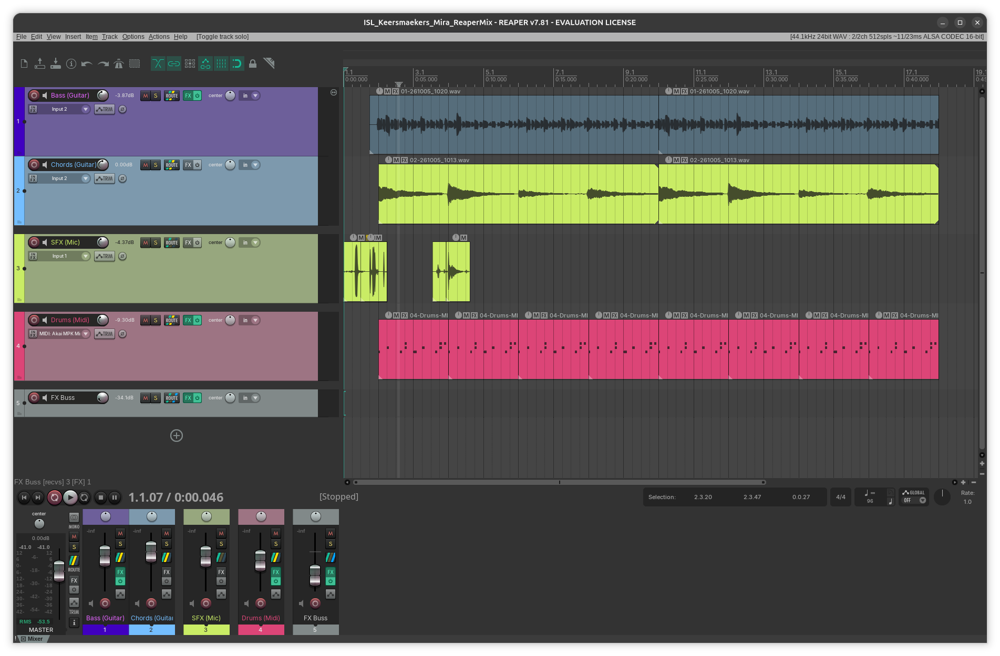

##### Step 3: Refine mix with gathered knowledge

### Resources

1. [Official docs video series: This is Reaper 7](https://www.reaper.fm/videos.php#0kEm36n8TKQ)

2. [Up and Running: A REAPER User Guide v 7.42](https://dlx.reaper.fm/userguide/ReaperUserGuide742l.pdf)

3. 

### Feedback

### Final Results

### Reflection

#### Before session of 06.10

- Learning by doing worked best for me: I went through the tutorials, and followed along with the software, as well as experiment a bit while watching them. This made it so I spent a lot of time on the videos itself, but I remember the contents of them a lot better.
- Quite a bit of problem solving, e.g. clunky at first with interface (eg accidentally making selections in the ruler all the time), MIDI recording also took a lot of practice, and figuring out how to use VSTs built for Windows on my Linux distro 
- Hitting the target dB in recordings didn't always work
- Making creative decisions at the start was very challenging, I felt too inexperienced to create something out of nothing. This was a mental block I had to get over
- Some of the coolest DAW features for me were the MIDI editor with quantization, and the concept of buses and sends. I am also really excited to learn about automation and actions.
- Still missing a lot of Mixing knowledge, but luckily that is my next topi
- Next steps: maybe first switching to mixing techniques? Then finishing tutorial series, learning more about FX, and applying automation.

### Notes & Timetracking

🕒 ***Total tracked time: approx. 18 hours***

---

  
Important keyboard shortcuts overview

  #### Keyboard shortcuts
  - `CTRL + P` preferences
  - `V` volume detail view
  - `P` pan detail view
  - `CTRL + R` start recording
  - `CTRL + T` new track
  - `SHIFT + G` Track grouping dialog
  - `ALT + B` Open virtual midi keyboard
  - `S` slices item at current timestamp
  - `SHIFT + F` FX Browser

  #### Mouse actions
  - `trim`:  middle of edges of audio files
  - `fade`: top of edges of audio files
  - `volume`: drag up and down from top
  - `stretch item` middle of edges while pressing 
  `ALT`
  - `Lasso selection`: right click drag
  - `Razor tool`: `ALT` + right click drag (hold `SHIFT` for multiple razor edit areas)

---

  
30.09.2026: 🕒 1 hour

  #### Introduction to tutorials: [Benefits of reaper over other DAWS](https://www.reaper.fm/videos.php#PJrN23efnbw)

- easy to download, try
- very small build size, opens and closes extremely fast compared to large DAWs
- portable install available so easy to bring a whole project to any device, have multiple versions with diff settings
- highly customizable: theme, prefs, mouse modifiers, menus,  toolbars, custom actions
- track links, comping (creating multiple versions then selecting the final)
- effect chains: group of effects and settings that can be reused ("save all effects as chain"/ "load chain" eg with keyboard shortcut), grouping effects together in "containers". 
- Freeze tracks: render fx into audio file, unfreeze when needed
- Effects can be not only set on tracks, but also on mediafiles within a track, so multiple parts in 1 track can have multiple different sets of effects.
- Unified track type: no difference track types needed for video, stereo sound or mono sound, midi / instrument track
- actions auto available based on mouse pos, modifiers available
- envelopes
- track(s) can be saved as "Track template", letting you import into diff templates, or just use copy/paste
- grouping, child tracks
- label with regions instead of markers. Regions can be moved around for changing arrangement
- automation items
- embed fx into tracks
- `Megababy`: step sequencer, easy to use and to explore when learning
- Easy switching between workspaces
-  Render queue

#### In action

Setted up pc, installed reaper for linux, thoughts: very easy to find, no issues so far

---

  
03.10.2026: 🕒 2 hours

  
  #### Video 1: [Intro](https://www.reaper.fm/videos.php#0kEm36n8TKQ)

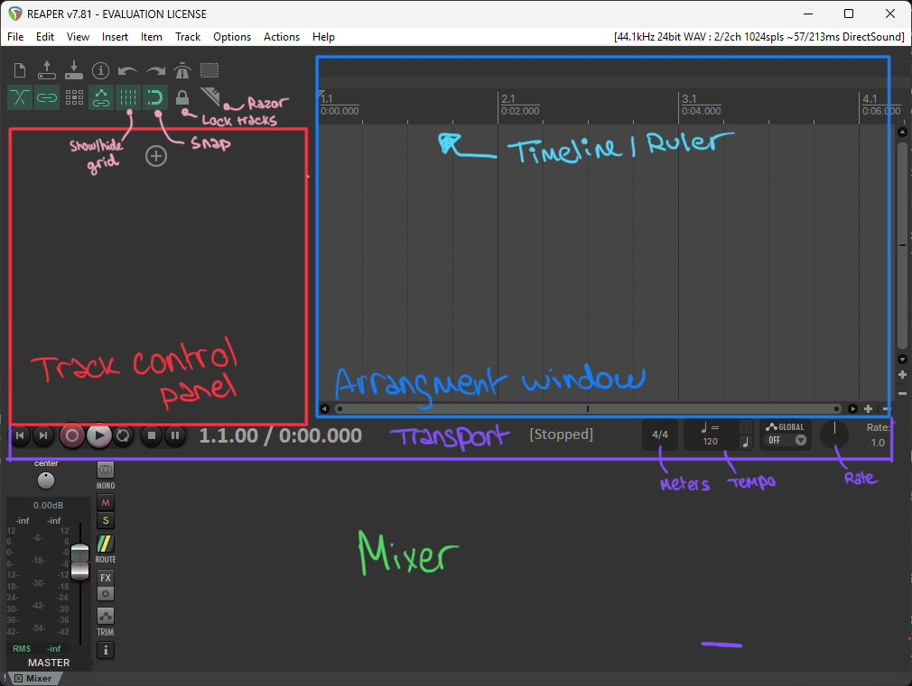

  - double click in tracks to generate new empty tracks
  - Timeline/ruler can be divided in multiple ways: bars:beats / mins:secs/ timecode / samples
  - Add samples by dragging into timeline or tracks,  below existing tracks
  - Toolbar: snap to grid
  - all files are **items**: basic actions such as copy/paste, trim (multiselect available)
  - by default, all items are looped, extendable by dragging out
  - Toolbar: razor tool to cut out part of samples
  - Track control panel: adjust volume, mute/solo (drag for multiselect), pan track, fx button, routing button (sends)
  - Adjust BPM, or rate, double click to reset to default
  - Context menu on right click of items, tracks, ruler, solo/mute button, ...

  #### Video 2: [Starting a New Project](https://www.reaper.fm/videos.php#hLB83sOxVfs)

- Top right of taskbar: see/change audio device prefs
- Sample rate: `48000`
- Block size: `128` -> Larger block size for larger projects, lower block size for less latency, 128 for balance

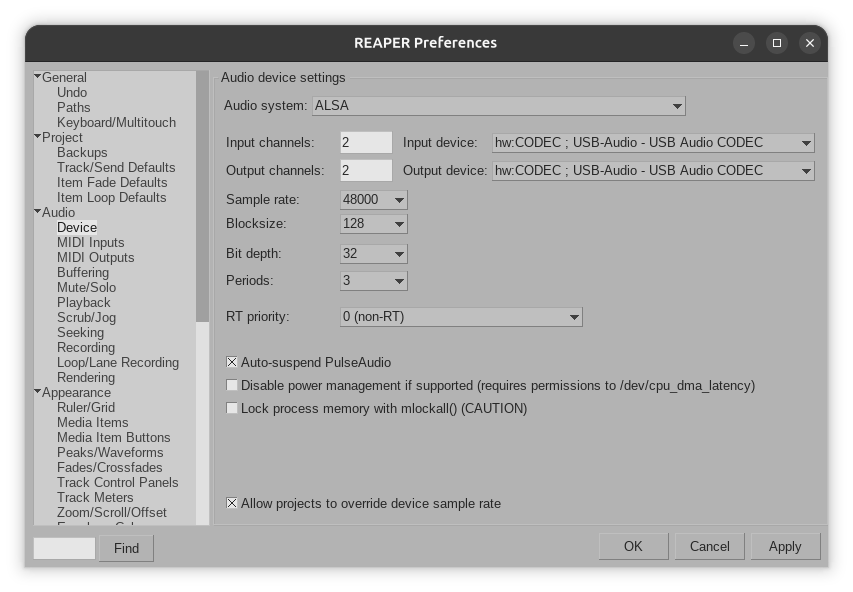

- `Preferences > Poject > Prompt to save on new project`
- Save project dialog: check `Create subdirectory for project` and `Copy all media into project directory`
- `Preferences > Project > Backup > Audo-save on timestamped file`
- `Preferences > Poject > Open properties on new project` -> opens Project Settings dialog on create
- Change project settings: `info` button in toolbar

#### Video 3: [The Tracks](https://www.reaper.fm/videos.php#L5E1enayMQY)

- Duplicate tracks (right click context menu)
- Rename multiple: double click one, then tab for auto selecting next track
- Create multiple: `Insert > Multiple tracks` or right click on track control panel
- Track menu also available on right click track selection
  - Color tracks: `Tracks > Track color > Set tracks to custom color...` 
  - Add icon to tracks: `Tracks > Track icon > Set track icon` 
  - Visual spacers: `Tracks > Visual spacer > Insert spacer before and after track` 
- Double click knobs to reset to default
- Grouping tracks: `SHIFT + G` opens Grouping dialog, linking properties between tracks within a group
  - Within a group: hold `SHIFT` to change individual track props
  - *Temporary groups* is same as multiselecting, `SHIFT` also works here

#### In action:

Setup of reaper on linux was easy, audio interface setup was plug and play with no installing of drivers needed. 

I followed along the videos to set up a project and test the guitar input, as well as the mic input with voice and violin. 
I adjusted the volume of the different tracks using the mixers, probably better way is too adjust the sliders to a good level during recording, will learn about this later. I made some cuts using the razor tool to made a first mix, but when I tried to loop one of the cut tracks by dragging it, it didn't work how i thought (extends original audio file, not the cut one), so i had to manually duplicate it with `CTRL` + drag. Continuing tomorrow with the rest of the tutorial videos to learn more about recording.

---

  
04.10.2026: 🕒 4 hours

#### Video 4: [Recording Audio - Part 1](https://www.reaper.fm/videos.php#CKHWK3oTj-A)

- Target level: between around `-12db` and `-18dB`, adjust knobs on interface to match this range
- Toolbar: Metronome
- Monitoring modes: right click on speaker icon in record mode, turn of `Monitor input` to not hear the output when recording.
- `Direct monitoring` setting on interface will eliminate latency alltogether, when using, turn off Monitor input in Reaper
- `Monitor input (Tape Auto Style)`: only hear the input track when recording is active, useful for overriding a part of the track (punch in/out)
- Punching in/out create different **takes**, click the one you want to hear in playback
- Choose one take and delete the other by selecting all audio in track (double click track), right click context menu, `Take > Crop to active take`
- Switch to `Tape mode` in `Options > New recording that overlaps existing media items > Trim existing items (tape mode)`
- You can extend the punches or crossfade with the existing take

#### Video 5: [Recording Audio - Part 2](https://www.reaper.fm/videos.php#U0Tv1waD1sY)

- **Auto punching**
  - `Options > Record mode: time selection auto punch`, in the ruler, draw in a time section where the recording will be active.
  - `Options > Record mode: auto-punch selected items`, use slices to split track into multiple items, then select the parts you want to overwrite
  - Recording modes also available on right click on record button in Transport 
- Record into **lanes** instead of using takes:
  - `Options > New recording that overlaps existing media items >  Add lanes`
  - To temporarily choose a preferred lane, but only hide not delete the other tracks, simply press `Disable lanes (hide non-playing tracks)` (right click on play icon by lanes)
  - Right click on lane, `Comping > Comp into new empty lane`. The comped lane are marked as gold, when double clicking it toggles comp mode.

#### Additional resources

*Go over these again in detail later.*

[Fundamentals of Rhythm for Electronic Music](https://www.youtube.com/watch?v=JE3QM_9sljI)

[Sound Design and Synth Fundamentals](https://www.youtube.com/watch?v=NJLIS2MkFe4)

#### In action

Started first recording session in Reaper, played around with a few riffs, then started appliying the principles from the videos, see details in Learning process.

  

---

  
05.10.2026: 🕒 6 hours

  #### Video 6: [Recording Midi](https://www.reaper.fm/videos.php#HOcJ31SIj68)

- Free VST instrument plugin: `Iota mini`
- Setup MIDI Keyboard: `Preferences  > MIDI Inputs`: select `input` / `all` and optionally `Control` (for linking with actions)
- Create track, select `Input: MIDI` as source, select all channels
- `View > Virtual Midi keyboard`
- MIDI recording: go to `in` at the track, select `Record: MIDI overdub/replace > Record MIDI overdub`, this won't overwrite the notes on the previous pass when adding more passes
- Metronome settings (right click): `Count-in before recording`
- Fix midi recording by double clicking to view `Midi editor`, this lets you clean the recording
  -  **Quantizing** the notes aligns the notes on the grid, press the `Q` icon for the `Quantize Events` dialog, Settings: `Manual`, Quantize: `All notes`, Grid: e.g. `1/8`
  - Quantize `Position and note end` to also align the notes' length to the grid (useful for basslines for example)
  - **Adjust velocity** by selecting all notes, then dragging up the velocity values (to set all notes to full volume)
- in `Iota Mini`, some good presets include:
  - `Trap Drum Kit 06` for Drums
  - `808 - Rumble` for Bass
  - `Keys - Eternity` for Keyboard
  - `Pluck - Soft` for Guitar
- Quantize during recording: in Track control right click IN FX `MIDI: All` button, and go `Track recording settings > Input Quantize MIDI recording`, also optionally select `Quantize note-offs`
- Set selected notes to same length: Selection > `Event properties...` -> length eg `0.0.2`

  #### Video 7: [Basic Audio Editing](https://www.reaper.fm/videos.php#EGL54WGa85A)

- Hold down SHIFT to temporary toggle snapping
- `Snap/Grid` settings dialog on right click: Turn off `Snap to grid at any distance` to have a less rigid snapping
- Right click on fade to adjust the fading curve
- Hold `Alt` to slide recording contents
- Split items using `S` key, select all, right click: `Heal splits in items`
- `CTRL` Drag to duplicate
- `Crossfade` icon in toolbar sets default crossfade on overlap off
- `Options > Trim content behind media items when editing` for avoiding media items playing at same time
- Lasso selection at right click + drag
- Multiselect fading only works with vertically aligned items

 #### Video 8: [FX & Plugins](https://www.reaper.fm/videos.php#lFDv75U0nO0)

- Find plugins by filtering on keyword (EQ, compressor, dynamics, etc)
- `View > FX Browser` (`SHIFT + F`) opens browser for selected track, or without selected track, drag and drop to tracks
  - Drag often used effects into `Favorites` folder
  - Create custom folders, optionally `Smart folder` where all effects with certain keywords can go
- Change order of effects in FX detail dialog
- Double click to pop single  effect into a floating dialog
- Right click on list: `FX chains > Save all FX as chain...`, it then appears into the `FX Chains` folder in the FX Browser
- Right click on `FX` icon in Track control panel, to see recently used, categories, FX Chains, etc
- Press off button next to `FX` icon to bypass effects temporarily (turns red)
- `ALT` click `FX` icon to delete all effects
- Drag and drop FX at a track to copy to another
- `ALT` + Drag and drop to move it instead
- The same actions are also available in the Track control panel and in the mixer
- In the mixer, holding down `SHIFT` while clicking lets you bypass effects seperately
- Normal FX do not change anything about the recording, but Input FX do get printed

#### Video 9: [Sends & Busses](https://www.reaper.fm/videos.php#pfHGwzNyFC8)

- `Route` -> `Master send` of parent track outputs to speaker
- `Route` icon changes color based on its mode: cyan when master send is on, yellow when it is being sent, and blue when a track is receiving a send
- Turning the master send off, can be useful when you want to `send` it to another track or a buss
- `Post-Fader`, eg when changing the volume of the send effects the buss's input audio, `Pre-Fader` (eg for headphone mixes) and `Pre-FX` modes available too
- Drag and drop from `Route` button to create a send, hold down `SHIFT` for multiple tracks
- Holding down `ALT` for turning off master send
- Why use sends ? Helps control multiple tracks at the same time (joined volume control, shared fx). Can be also useful for creating **parallel effects** where you can blend in a version of itself, eg highly distorted 
- Also possible to use sends/buses as fx returns: create reverb on a buss, then adjust the balance in the `Routing` window under `Sends` / `Receives`

 #### Video 10: [Folders](https://www.reaper.fm/videos.php#GGY4UYBbxyM)

- Folders are containers for multiple tracks, used for similar reasons as busses/sends
- To create a folder from a track, go to the `Folder` icon in the left bottom of the track, which then turns into a plus sign, sending all tracks underneath into the folder. Alternatively drag and drop tracks into `Folder` icon of parent
- Folders are nestable, opening up interesting workflows. Allows us to control things in a broader way, eg all drums, all guitar, etc
- Folders are collapsible on two additional levels, keeping big projects neater.
- Actions > filter on 'Folder' > Track: Cycle folder collapsed state` -> add keyboard shortcut if used often
- Tracks are also intended based on folder level, when it is missing turn back on in context > `Show folders`
- Subtracks can be hidden in mixer by unchecking context > `Show tracks that are in folders`

#### Video 11: [Track Grouping](https://www.reaper.fm/videos.php#3tmI88BKnb8)
#### Video 12: [Markers & Regions](https://www.reaper.fm/videos.php#3tmI88BKnb8)

-  
#### In action

To use VST's built for windows on linux, I followed this guide on reddit into using `yabridge`: [Reaper and VST support on Linux (Mint)](https://www.reddit.com/r/Reaper/comments/1o4o05s/reaper_and_vst_support_on_linux_mint/). After fixing the compatibility issues, the plugin shows up correctly. Spent some time getting used to recording with the MIDI keyboard.

By default, the routing buttons where turned off in my interface. I reenabled them by setting the layout of the track control panel: `Options > Layouts > Track Panel > (View) B`

Continued on prototype by adding MIDI drum track, and started playing around with FX.

Improving mix: approx. 5 hours

## Mixing Techniques

### Learning process

#### Motivation
*Learning how to mix* is a crucial step towards becoming an audio professional. I chose this skill area because mixing is one of the most fundamental, yet exciting, aspects of audio production for me. I want to learn how to shape sound intentionally. To achieve this, I decided to start with the basic concepts of mixing and develop an overarching understanding of mixing decisions before diving into the details of individual tools. I know I won't become a music producer by the end of this course, but I hope to develop a shared vocabulary with my coworkers and sharpen my critical listening skills. I want to understand how individual tracks come together in a mix and take the first steps into creating my own music: every music lover's dream.

#### Step 1: Learning the basic concepts and practices around mixing and setting up a reference library

I read through the first five chapters of **Mixing Audio** by Roey Izhaki, making clippings to create an overview that I can refer back to when needed.

The `Introduction` and the first chapter, `Music and mixing`, frames the concept of mixing as a machine to craft the sonic aspects of music and sound. One of the tracks mentioned in the first chapter, is Vic's and Wallace's mixes of Nirvana's Nevermind. Listening to and comparing both helped me understand how different mixing approaches can create drastically different results. The chapter also mentions a tool I found very helpful, namely creating excerpt sets, as a way to compare mixes, without allowing your brain to reset inbetween.

The second chapter, `Some axioms and other gems` helped me get a better understanding of the main paradigms around mixing (louder is better, percussives weigh less, and the concepts of importance and natural vs artifical approach). I found specifically the natural vs artificial concept interesting, as I never really though about mixing in this way, but it resonates with me a lot.

In the third chapter, `Learning to Mix`, I learned about Mixing Vision as circular process, constantly moving between vision, action and evaluation. It helped me have a better idea on how to describe my vision, and how to concretely start a mix by active listening and setting up the vision. It also mentions the importance of having a well set up reference library.

After working through the first three chapters, I started setting up my own reference library. I got sidetracked here into developing a simple web app that lets me tag songs and add observation notes, as I didn't want to rely on yet another third-party service.

I first created the datastructure out of my rough idea, which was to allow me to import songs from Spotify and annotate, categorize, organise, and filter them. [continue here shortly describing the dev process of my app]. 

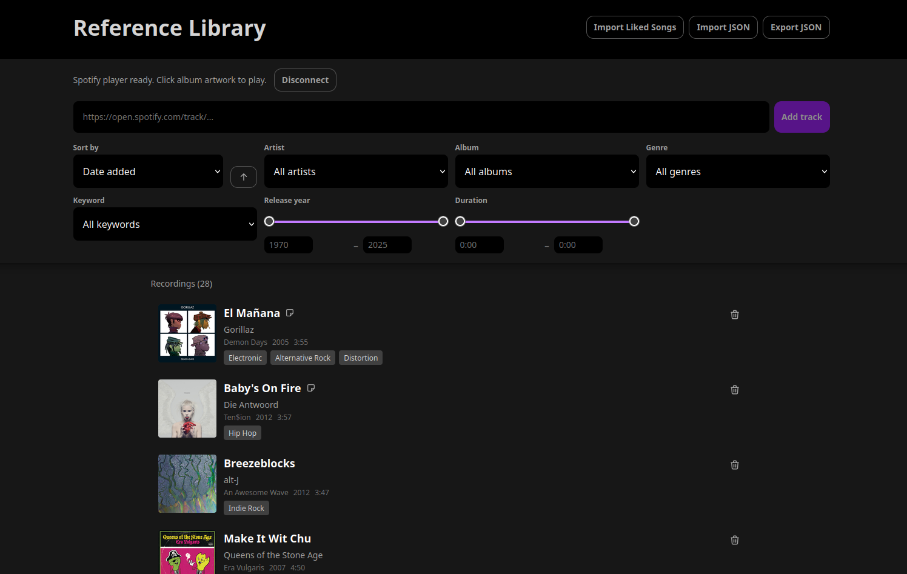

I started going through my Liked Songs, and added those whose mixes caught my attention the most. My goal is to establish a routine where I get the reflex to add songs to the library and add relevant notes and tags. This would allow me to at a later time sit down and do some critical listening exercises, to have my own database of recordings, allowing me to practise identifying different mixing characteristics. My plan is to also implement some type of excerpt set generator, or other comparison tools between different mixes (as well as of course style the app properly and improve its UX).

The fourth chapter, `The process of mixing`, was one of the heftiest chapters, talking about arrangement, recording approaches, practical first steps . Luckily the book is very well written and easy to follow, allowing to get a broad basic knowledge of the mixing concepts. It also discusses an approach to drum mixing, which i found very useful. 

As much as I was at this point aching to start a proper mixing session, I wanted to get through chapter 7, `Mixing domains and objectives` first, so I had a more practical sense of what to pay attention to. This chapter beautifully lays out the different mixing domains and the objectives they each affect. It starts by outlining the 4 principle objectives 

The listening exercises in chapter seven focus on differentiating between frequency bands. A drum reference track is divided into its **low**, **low-mid**, **high-mid**, and **high** bands. The exercise is then repeated with a vocal track.

I found it helpful to switch between the reference track and the isolated track. Hearing the differences took some time; the vocal example was considerably harder to distinguish than the more clearly separated frequency ranges of the drums. I found the difference between the low-mid and high-mid frequencies in the vocals interestingly distinctive. A useful technique was to import the audio files into a new Reaper project and adjust the levels of the different frequency bands during playback. This let me compare different proportions of each band.

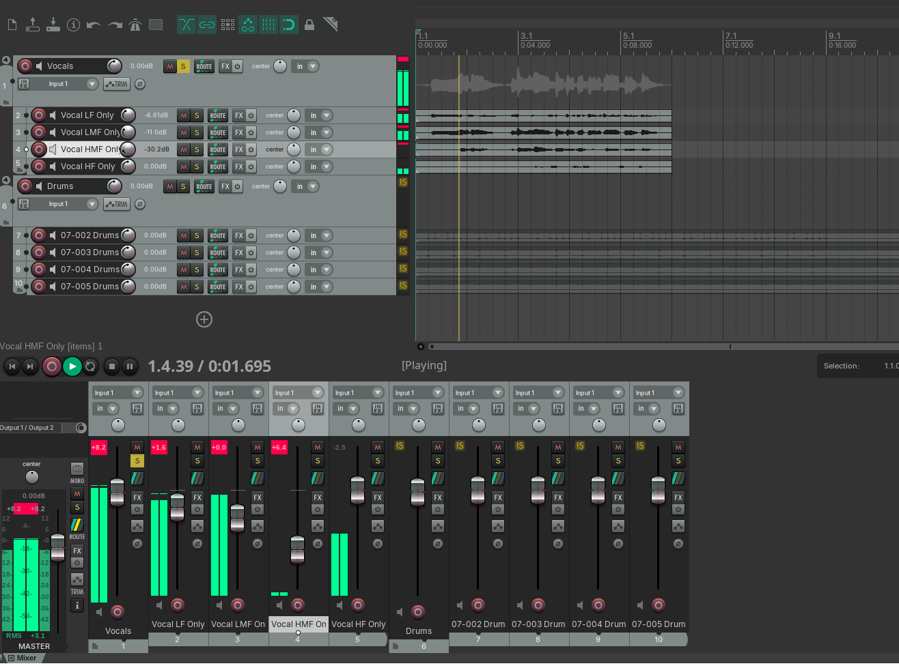
*Comparing frequency bands in Reaper*

#### Step 2: Explore meters, equalizers, and panning while creating the first version of the mix

In the next step, I started the multimix, while simultaneously reading deeper into the topics of Meters, EQ and panning.
wanted to start the 
##### Choosing the recording

I chose the multitrack session [Human Radio multitrack session](https://www.telefunken-elektroakustik.com/multitrack/human-radio-radio/), from the multitracks hosted by TELEFUNKEN Elektroakustik.

I chose this recording for a couple reasons. First, I filtered by Studio recordings, as I will mix a Live recording for another class, and want to compare the difference. I also assumed that working with studio recordings would be more within my comfort zone, as there is less need to deal with overdub processing and other issues. I am also very familiar with the genre as a listener, which will hopefully help me create a beautiful mix. The track count is also very managable, and the tracks where consistently named, so it seemed overall a very beginner-friendly project.

The session is documented with the following info:

> On Thursday, March 29th, TELEFUNKEN Elektroakustik hosted a microphone clinic and listening party at Java Jive Studio in Nashville, TN. The event featured TELEFUNKEN microphones exclusively on each instrument and voice. The music was performed by Human Radio, an American pop-rock band from Memphis, TN.
>
> The original song “You & Me & the Radio” was recorded through a D&R Cinemix console in Pro Tools HD at 24/44.1 through Black Lion modified 192 converters. No EQ or compression was used.
>
> Microphones featured in this session include the AR-70 Stereo on drum overheads, M80 Dynamics on snare and toms, and the new M82 Kick Dynamic on the kick drum. The M81 Universal Dynamic and AK-47mkII were employed on guitar rig, with the M80 Dynamic and CU-29 Copperhead positioned on the electric bass amp. Organ was tracked with a stereo pair of ELA M 260s and a stereo pair of CU-29s were stationed on the grand piano. The male lead vocals were cut using multiple microphones including the ELA M 251E, U47, CU-29, AR-51 and AK-47mkII.
>
> The multi-track files from this recording session are now available for download as part of the latest installment of the TELEFUNKEN Multi-Track Session Files. The audio files are presented as 44.1k / 24bit .WAV and can be imported into the digital audio workstation (DAW) of your choice and are zipped (using 7-Zip) in groups for ease of download. All the files are clearly labeled in the same format with the source listed first (LEAD VOX, ACOUSTIC, PIANO), followed by the microphone used (C12, AR-51, etc), and then the make and model of pre amplifier (BAE 1073, Manley, Neve, API, etc.).
>
> The session description states that the song was recorded through a D&R Cinemix console in Pro Tools HD at 24-bit/44.1 kHz, without EQ or compression during recording. The session features multiple microphones on several sources, including the drums, guitars, bass, organ, piano, and lead vocals. This gives me an opportunity to explore how the individual recorded tracks can be balanced and shaped during mixing.

##### Session preparation and mixer organization

Before making detailed mixing decisions, I organized the session to make it easier to navigate and understand.

I renamed some files for clarity. For example, *Guitar 6* appeared to refer to the same sound as *Guitar 5*, so I checked the tracks and adjusted the naming where needed. I also added visual spacers and assigned colors to make the tracks and instrument groups easier to distinguish.

I soloed duplicate or similar tracks so I could compare them and understand their individual contributions to the rough mix. I also enabled the option to collapse folders in the mixer. This made it easier to focus on particular instrument groups and adjust their levels without displaying every individual channel.

This setup was helpful during the initial listening sessions. It reduced visual clutter and allowed me to make rough level adjustments across instrument groups. It also gave me a more structured starting point for the detailed mixing work.

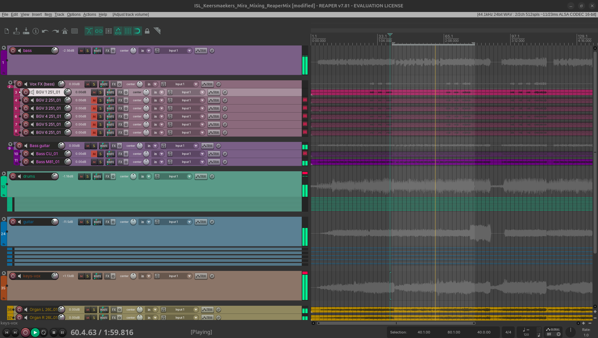

*Setup of the tracks in Reaper.*

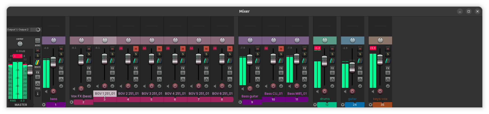

*Setup of the mixer in Reaper.*

##### Initial listening and assessment

I listened to the song several times, both as a complete mix and by focusing on individual tracks and instrument groups. My goal here was to become familiar with the arrangement.

**First impressions**
- Genre is really comfortable, I would roughly classify it as Indie Pop Rock, the synth give a nice oldschool vibe to it
- Love song with simple lyrics, playing on a nostalgic vibe of sitting with going on a roadtrip with your love and vibing on the music. 
- There is a lot of overclipping happening due to duplicates in the track - solve first to create better rough mix
- Synths become very montone very fast, needs a lot of variation to do its purpose justice
- Right now very onedimensional
- The  guitar track has very nice harmonic holded notes, is barely distinguishable in the master track, must give it place to breathe, at 01:22 might be an opportunity to play this riff solo
- 02:02 / 03:30 Performance of high notes is inadequate, must be processed heavily to land well
Chill energetic vibes

Lyrical things that stand out:

- 00:21  (I gave my love a red, red rose and it was) ***tick tock, tick tock** -> interesting element to play with
- 00:36 I can't close to real emotion... (emotional moment, climax needs to be fitting) 
- 01:09  Perfection in stereo
- 01:17 "You and me and the radio" title drop, emotional shift from raw to intimate
- 01:42 "And life is sweet and dangerous, but dont be frigthened"
- 01:58 "When the song hits hard with the drums and guitar" very explicit almost an instruction
- 02:14 "Rolling down the mountain as there's no way we're going slow" climactic moment again, needs focus
- 02:52-03:06 "I gave my love...", back to the start of the song, going very melanchonic again here
- 03:06: "Let's Rock, now we're rolling..." repetition of before again this time breaking the melanchonic feelings to raw feelings

**Mixing vision**

This is my first thoughts around a mixing vision for the track, I will later revise this once I get more ideas of what to listen for:

***Mood***

Create an intimate sound space, at moments felt as though it is only shared by the two lovers. For this, we also need more contrasting, open vibes at certain times in the song, maybe making the listener feel as though they switched to a different context.

***Balance*** 

Create a balanced level arrangement, so that each instrument gets its stage within the song (for this I need to learn about automation first). Make sure all instruments occupy their own space in the frequency spectrum, and create an interesting stereo balance throughout the song.

***Definition*** 

Make the lyrics more hearable and defined, and put them in focus during important parts.

***Interest***

Create variety, as the song involves, the arrangement should change to give every instrument its stage.

##### First experiments: levels, meters, EQ, and panning

I first focused on initial mic selection, deleting the tracks I most likely won't need, as I can always add them back in later.

I rearranged the order of the drum tracks to make more sense to me: Kick, Snare, Tom, Hat, Tambourine, All, Room. For the OH and Room drum tracks, (send to master in Left and Right channel only, adjust pan to 100%. when listened in isolation makes the drums immediately more dynamic). 

I muted the individual tracks so I could blend them back in at a later point in time. I reduced the Room sound a little bit.

 
For the Bass Guitar, I used the CU mic as it had a better clarity, and removed the other mic for the time being. I now had a single track to work with.

The guitar mic selection was more time-consuming. The AK and M80 mics used produced completely different results, with the AK being a clean track, and the M80 containing the reverbs and distortions. I kept both mics unmuted but turned the level of the M80 mic much down.

Guitar 1 and 2 are two takes of the same track, with some parts having been added back in. I used the take 1 for the more interesting start riff, and take 2 during the clean split, but I'm planning to later still cut more in detail. I discarded guitar 4 for now as I preferred the Guitar 3 for this take. 

For the vocals, the 251 mic was the better choice as it gave an overall better clarity.

Next, I roughly panned some of the instruments as if they would appear on a stage, with the vocals in the center, and the other instruments arranged around it . Detailed panning was hard without a playback system, so I moved on to first EQ adjustments.

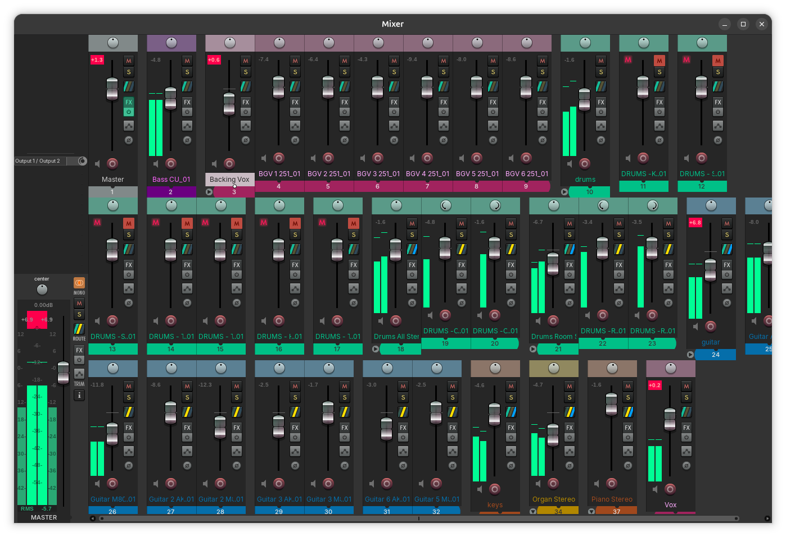
*Initial rough mix*

I started with adding the individual drum tracks back in and cleaning up the sound of each.
I added high-pass filters accross the different drum tracks, with as goal to clean up / define certain bands on the spectrum. I then muted the joint track, and blended in with the room sound to preserve some natural sound. 

I continued adding EQ adjustments to bass, guitar, and keys, trying to improve each sound by amplifying the frequencies that added the most to the overall sound, and reducing those that other instruments occupy, but not overdoing it, so that the samples didn't become too flat. Here it was helpful to toggle the effects on and off regularly. I found it in general the most helpful to work on a progressive basis, starting with solo'ing a single track, then slowly adding the other tracks to hear it in its context and adjusting where needed.

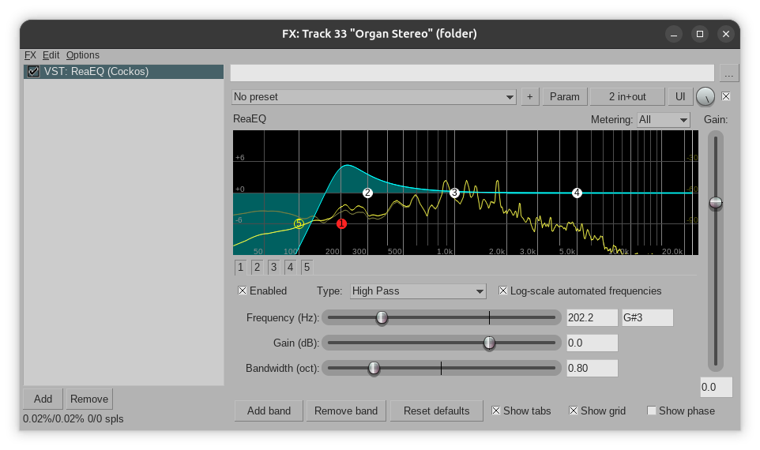
*EQ Settings for Organ track: explain later*

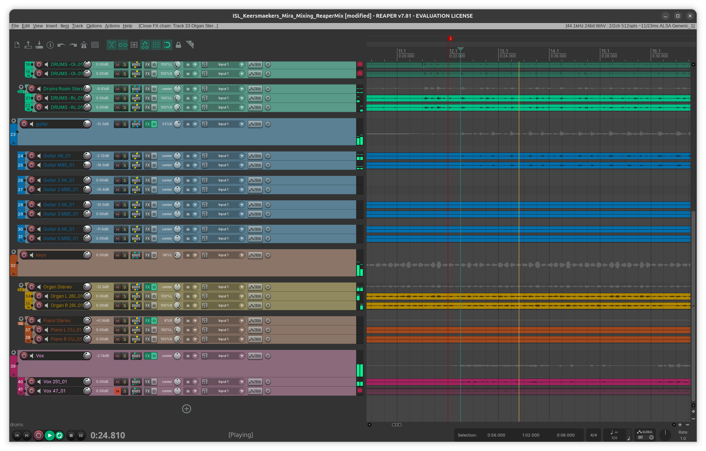
*Mix after setup and first EQ changes*

#### Step 3: Finalize mix

As a switch from the information heavy literature I decided to watch the start of [David Gibson's "The Art Of Mixing"](https://www.youtube.com/watch?v=TEjOdqZFvhY&t=651s) to let the concepts of the book truly sink in. This extremely well made video series was first published in 1997 (coincidentally my birth year), and creates a framework for displaying sounds visually.

The videseries starts by exploring how sounds can be positioned within a stereo mix, how each type of studio equipment affects sound, and how different mixing choices shape the musical experience. One of the main takeaways was that there is no single correct way to mix. Instead, understanding the conventions of different genres and developing my own mixing values allows you to use technology creatively.

It went into depth about the concept of **imaging**, which describes the perceived position of sounds within the space between speakers. I learned how mixing creates a three-dimensional soundstage: panning positions sounds from left to right, volume controls their perceived distance from front to back, and EQ helps shape their position from top to bottom through frequency adjustments. Together, these techniques allow sounds to be placed and moved within the mix.

I also learned how different processing techniques influence the perceived distance and size of sounds. Increasing volume, boosting mid and high frequencies, and using short delays can make sounds appear closer or fuller. Reverb and longer delays can create a sense of distance. These effects can be combined with panning, volume, and EQ to shape the position and character of individual sounds.

Another important concept was **masking**, which occurs when one sound makes another harder to hear. Sounds that occupy similar frequency ranges or compete in volume can obscure one another, making the mix feel muddy. This helped me understand that mixing is not just about adjusting individual sounds, but also about managing the space they occupy so that they remain distinguishable.

Finally, I learned how effects such as short delays can widen and thicken sounds without creating a noticeable echo, while reverb introduces a sense of acoustic space. Both can be manipulated to influence how sounds interact within the mix. Mixing can therefore be equated to the creative placement and movement of sounds, using space, depth, frequency, and dynamics to shape the listener’s experience.

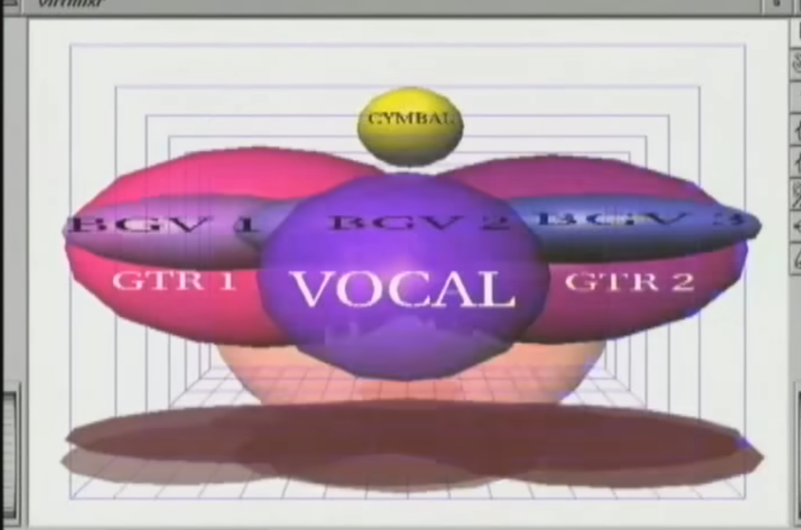

To finalize my artefact, I wanted to add more dimension to the song. I focused on the first 90 seconds of the song from now on. With my newly learned Soundscape analogy, I started to "move" my tracks around through drawing volume envelopes. I tried to identify different moments in time where i wanted to move the instruments around to create a mix that sounded more interesting to me.  

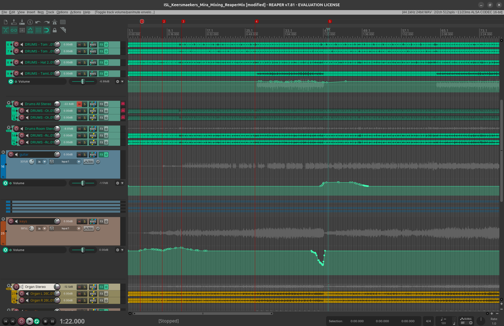

After many hours in Reaper, I was happy enough with how the song turned out. To finalize, I checked the loudness peaks in the `Loudness Meter Peak` on the master buss, and noticed it was quite a bit heavy on the  left side. Trying to balance the song out, I panned the bass a bit further to the right, and split up the panning of the organ and the piano. I gave it a final listen and am overall happy with the progress I made.

### Resources

- Mixing Audio, Roey Izhaki
- [TELEFUNKEN Elektroakustik: Human Radio multitrack session](https://www.telefunken-elektroakustik.com/multitrack/human-radio-radio/)
- [David Gibson: The Art Of Mixing ](https://www.youtube.com/watch?v=TEjOdqZFvhY&t=651s)

### Feedback

Reference app could be very uselul for the other students - refactor and bring the MVP to production

### Final Results

### Reflection

Before starting the Mixing Techniques topic, the assigments we received in other courses where very intimidating, I was asking myself *what do you mean, just create a mix, how do I even start?* Now on the other hand (even with my very limited knowledge of different mixing techniques), I can identify what sounds goo envision how certain techniques would manipulate the mix, and more important, how to match my mixing vision. I am developing a concrete plan of action

### Notes & Timetracking

🕒 ***Total tracked time: approx. 36 hours***

Reading though the book and first version of prototype: 27 hours

#### Introduction

- What is *really* the origin of mixing? Orchestral pieces as primitive form of mixing, placing people in certain areas of the room to create a well rounded, sonic combination of intstruments
- Intrinsically tied to the technologies: **multitrack tape machine** signifies start of mixing as we know it. It allowed us to repeatedly play recorded sound before commiting to its sonic treatment in the mix. More control over the individual tracks, rather then just the master
- 1996: `Cubase VST` as first audio plugin as we know it: "Software that can
perform realtime audio calculations using the computer’s CPU"
- Improvement of CPU power, **project studio**, as a studio running on your pc (contrasted with professional studio who now more compete on acoustic quality rather then abilities)
- This allowed for the democratization of mixing, as a side effect though professional mixing (traditionally the only focus of a certain employee), is now just a part in the process
- First, barely any literature about mixing, now the opposite, overwhelming amount of sources. This book aims to collect all info in 1 place.
- Biggest miconception: Mixing as purely technical skill, in reality the technical aspects can be mastered, but creating an interesting listening experience is a completely different skill. This entails the **crafting of sonic aspects of music** "*shaping sounds, crystallizing soundscapes,
establishing harmony between instruments, and building impact all rely on the many
creative decisions that we make*" -> **mix as sonic portrait**
- Mind listening safety!!

   
eq, panning, compression, busses / sends, reverb

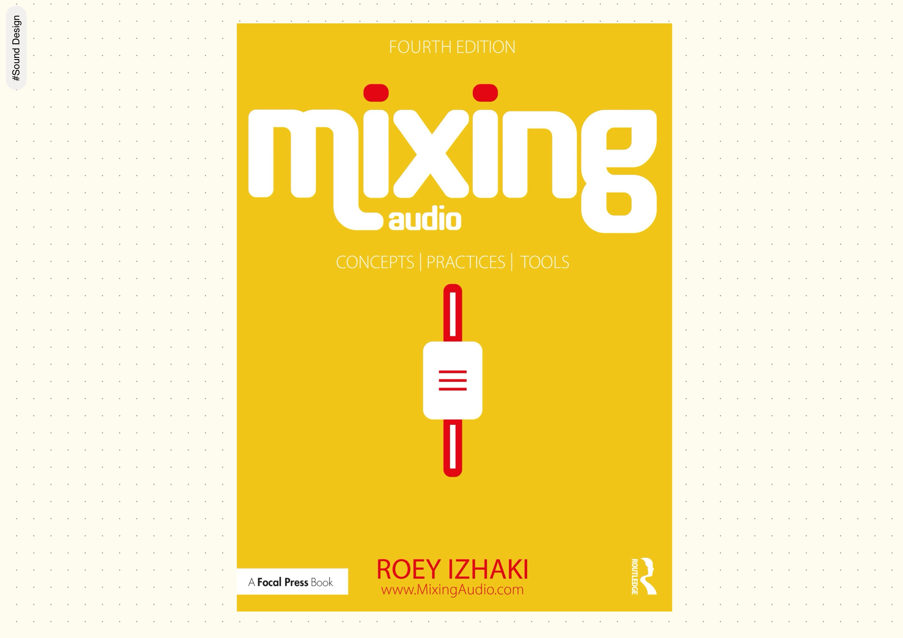
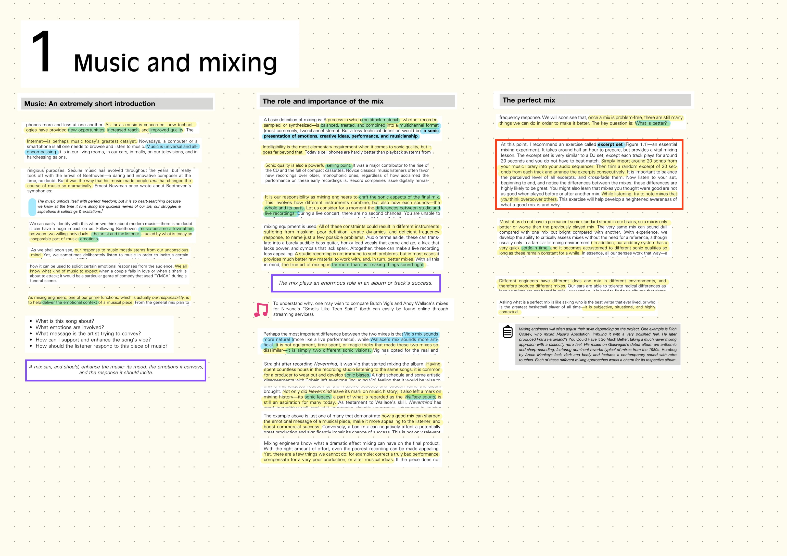
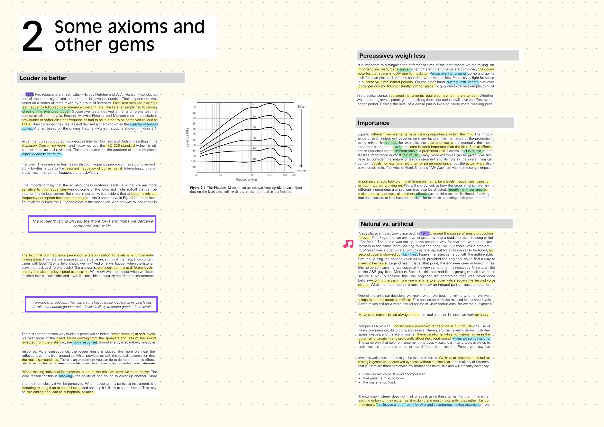
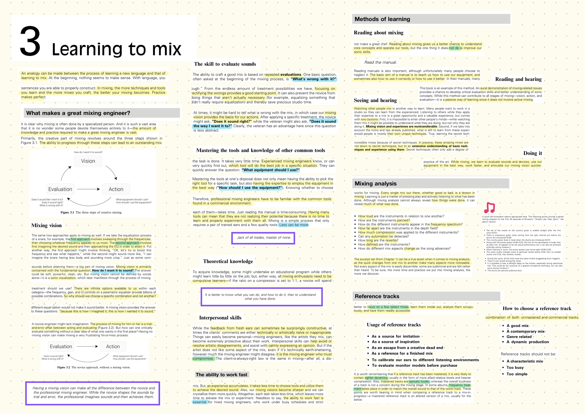
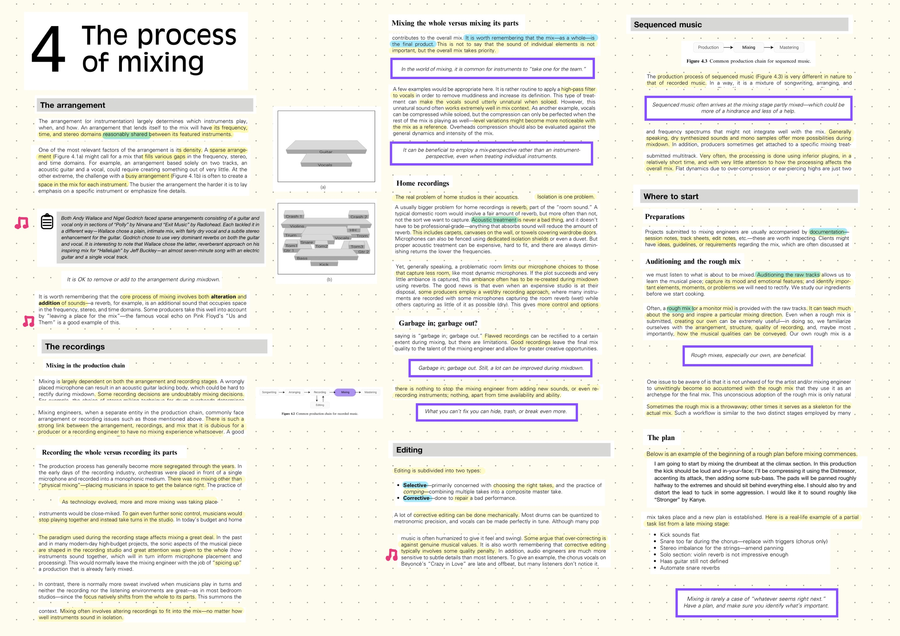
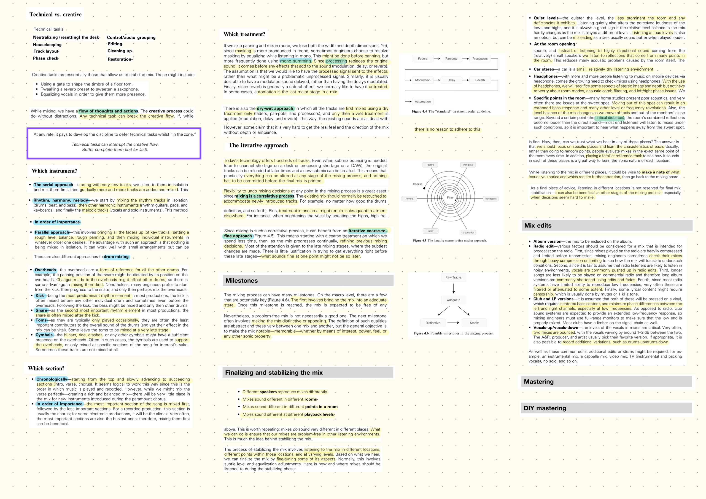
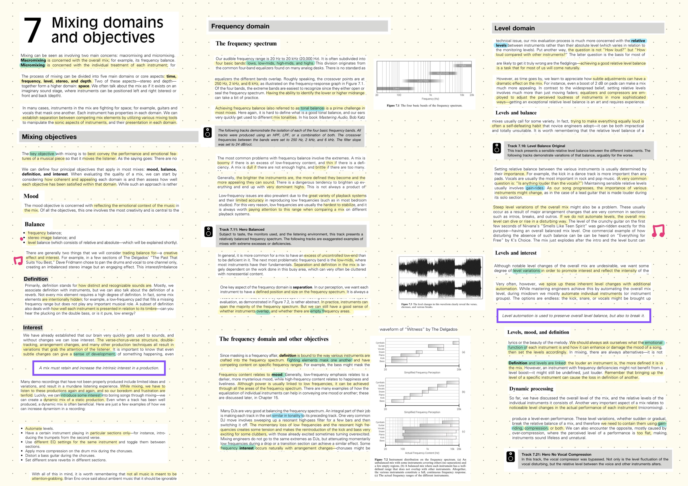
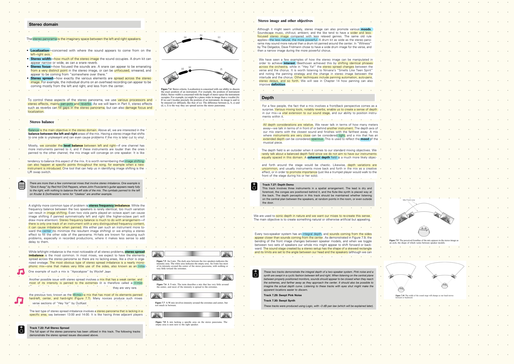
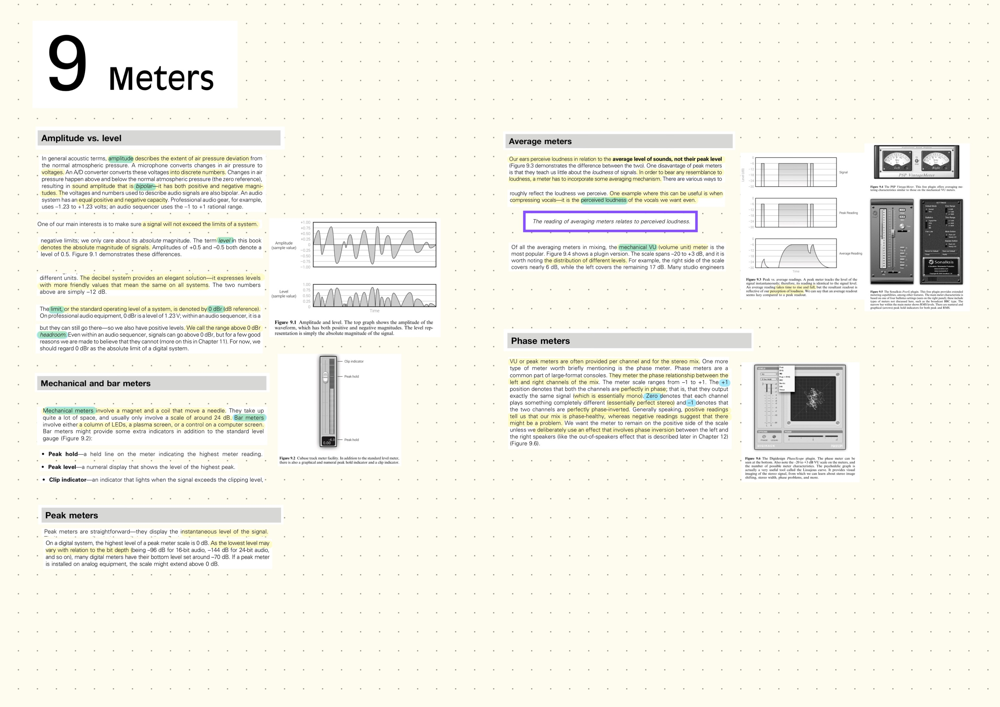

David Gibson tutorial + improving mix: approximately 9 hours

**Notes for ["The Art Of Mixing", David Gibson](https://www.youtube.com/watch?v=TEjOdqZFvhY&t=651s)**

3 parts:

1. Visual representation of the placement of sound between speakers
2. Basic functions of each piece of studio equipment
3. Musical dynamics

0:02:50
 - No one correct way of mixing, but help preparing every type of situation
 - To make art out of technology
 - Point out common values that people hold for mixing different styles of music, based on history of the genre
 - Develop your own mixing values

0:10:19
- How does each piece of equipment affect `imaging` (the apparent placement of sound between speakers)
- Pan **left to right**: between both speakers, furthest to left speaker / furthest to right speaker (some people give it some extra space next to them)
- "Sound comes from anywhere inbetween" -> already a figure of speech, as in reality it is the stereo hearing that makes it feel that way --> **imaging** (figment of imagination), often it is not there at all (eg sleeping, not paying attention, wrong ear shape). 
- Volume is mapped as a function from **front to back** If you want something in the front, turn it up, if you want something in the back, turn it down
- Front/Back placement can also be achieved with compressor limiters, boosting EQ in mid/ high frequency range, short delays less than 30ms (fattening), making a sound unusual to stand oit
- Reverb and long delay times can make a sound appear more distant
- Example thunder: past experience can make it feel further away
- Imaginary distance from speaker is dependant on multiple factors: the larger the speaker, the further in front, how active the imagination of the observer.
- Higher frequencies appear as higher abover the frequencies, while lower frequency appear to be low. For multiple reasons: Tweeters in the speakers are often physically higher then the woofers; Lower frequencies can be felt through the floor; stomach as low frequency resonator and head as high frequency resonator
- Parallel with chakras, which are also going from bottom to top
- **Top to bottom** is therefore frequency axis
- Limit top: underneath ceiling (high frequencies can't be heard through ceiling), limit top: at floor
- This creates our 3D space, as a limited stage where sounds can be placed
- The main issue is therefore **crowd control**
- Moving sounds anywhere in the stage: through `panning` (left/right), `volume` (up/down) and `EQ` (small amounts top/bottom)

0:24:21
- Goal: Show how much space each sound takes, dealing with the big problem of **masking** (one sounds hides another)
- Analogy: 3 bass guitars (takes up entire space for total mudiness), or 10 bells (each still individually hearable)
- Louder sounds also mask the quieter ones
- Oblong spheres: with short delays under 30ms, you create a left/right effect that is too short to be heard as echo, stretching the sound between both speakers (fattening). This oblong sphere can also be moved with pan, volume and EQ
- Reverb places the room sound into our space. Similarly, it can be moved with pna, volume and EQ
- Art of mixing is thus the **creative placement and movement** of these sound images: sparse vs full, assymetrical vs symmetrical, still or movement. Being aware of all possible musical dynamics that can be created

0:29:44

Next steps: work on 

## Audio Technology

### Motivation

I had my first contacts with field recording nearly 10 years ago during my bachelor, and . One of my main interests in Sound Design is working with embedded device (...). It is therefore crucial to understand (...). The subpath "Microphones & Recording" is the best match, as I need recording (...) Since there is only a limited time left for this learning path, I will focus on the difference between dynamic, ribbon and condenser mics, as well as study pickup patterns. 

### Learning process

Step 1: Go to the studio to record a variety of sound with 4 different microphones

After f

(explain studio session at KUG)

Step 2: Learn about the inner workings of dynamic, ribbon and condenser microphones.

Next, I started reading the fourth chapter of `Modern Recording Techniques`, which explains the inner workings of different microphone types: dynamic, ribbon and condenser.

(write reflection about notes )

Step 3: Create a comparison table between the microphones

I started by finding the technical specs of each of the microphones:

- [Schoeps CMC64](https://vintageking.com/products/schoeps-microphones-cardioid-st?srsltid=AU7gw4UgWewG_fCUaMIn2Diea0IdEi7UkkGRSzp69QpUr9UzgDzxPJg7)

- [AKG C414](https://www.coutant.org/akgc414uls/c414b_uls.pdf)

- [Sennheiser MD441-U](https://www.sennheiser.com/en-at/catalog/products/microphones/md-441/md-441-u-000762?srsltid=AU7gw4W7-kSguHJ5RBf7IH1_rS-L4JSyNPwqUNyq3nfBYJD95EzqJpU9)

- [Audix D6](https://www2.spsc.tugraz.at/add_material/audiotechnik/manuals/50_Mikrofone/Audix/audix_d6_manual.pdf)

For each microphone, I looked up their categorization, their frequency response charts, and their Polar Patterns.

I then summarized my findings in a comparison table.

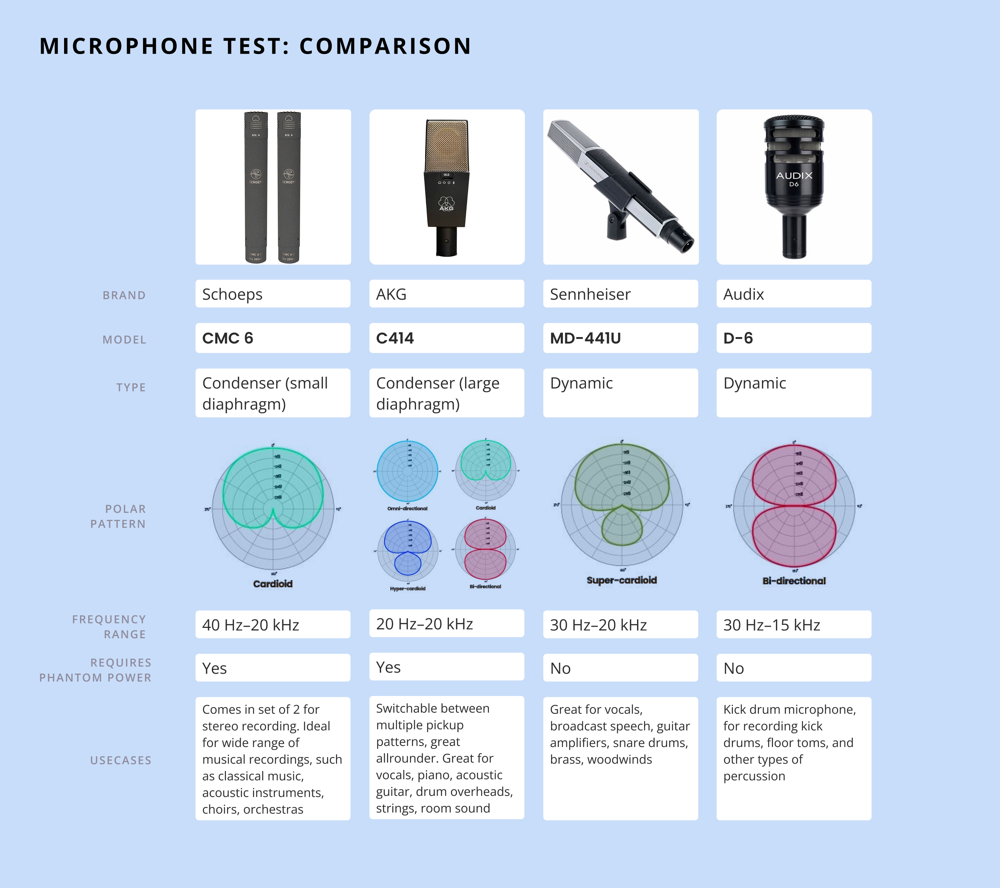
*Comparing the 4 different mics*

### Resources

- Modern Recording Techniques (David Miles Huber, Robert E. Runstein)

Image sources for comparison table:

- [Polar pattern charts](https://www.globalavisual.com/polar-patterns-in-microphones/)
- [Schoeps CMC64](https://vintageking.com/cdn/shop/files/schoeps-cmc-64-stereo-set_15877_2_189891da-1d19-4d95-85f1-42f2408a04d4.jpg?v=1787088236)
- [AKG C414](https://www.oxfordsoundhire.com/wp-content/uploads/2024/01/AKG-414.jpg)
- [Sennheiser MD441-U](https://thumbs.static-thomann.de/thumb/padthumb600x600/pics/bdb/_12/126815/14186272_800.jpg)
- [Audix D6](https://thumbs.static-thomann.de/thumb/padthumb600x600/pics/prod/160142.jpg)

### Feedback

### Final Results

### Reflection

### Notes & Timetracking

🕒 ***Total tracked time: approx. 6 hours***

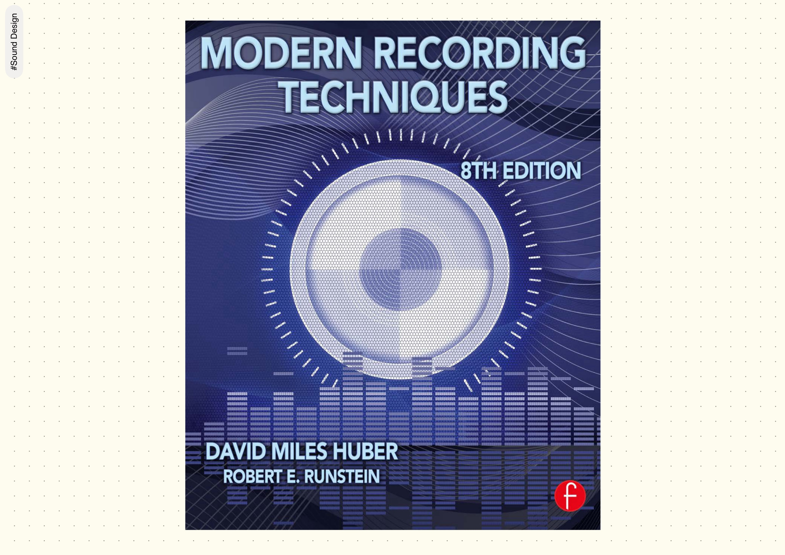
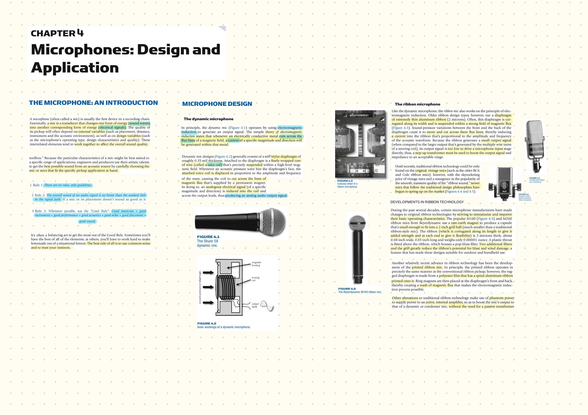
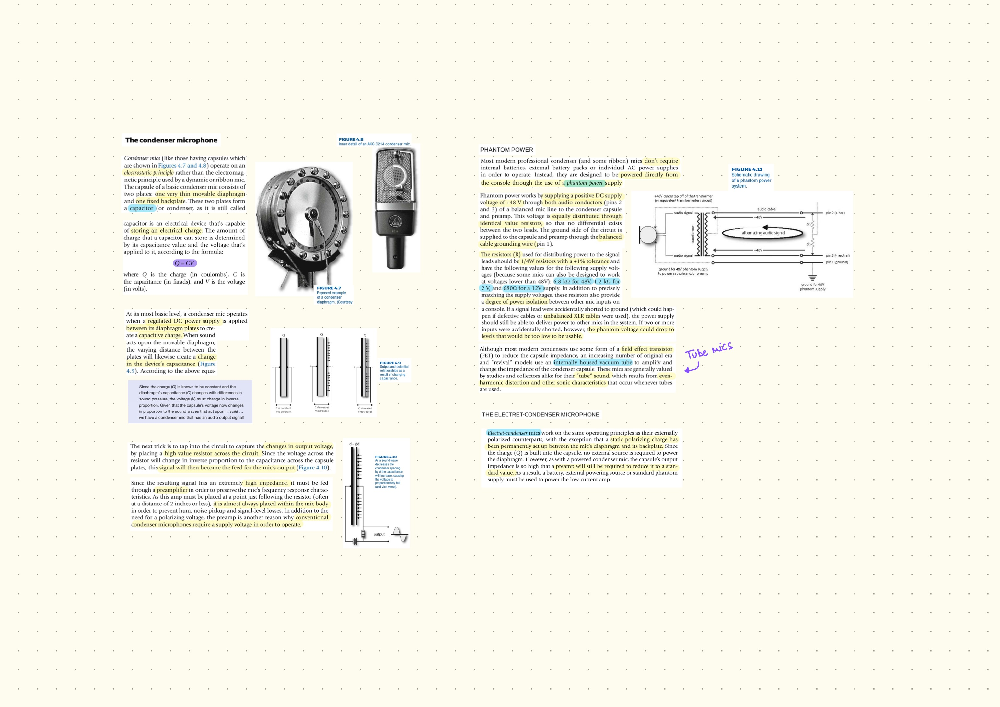
